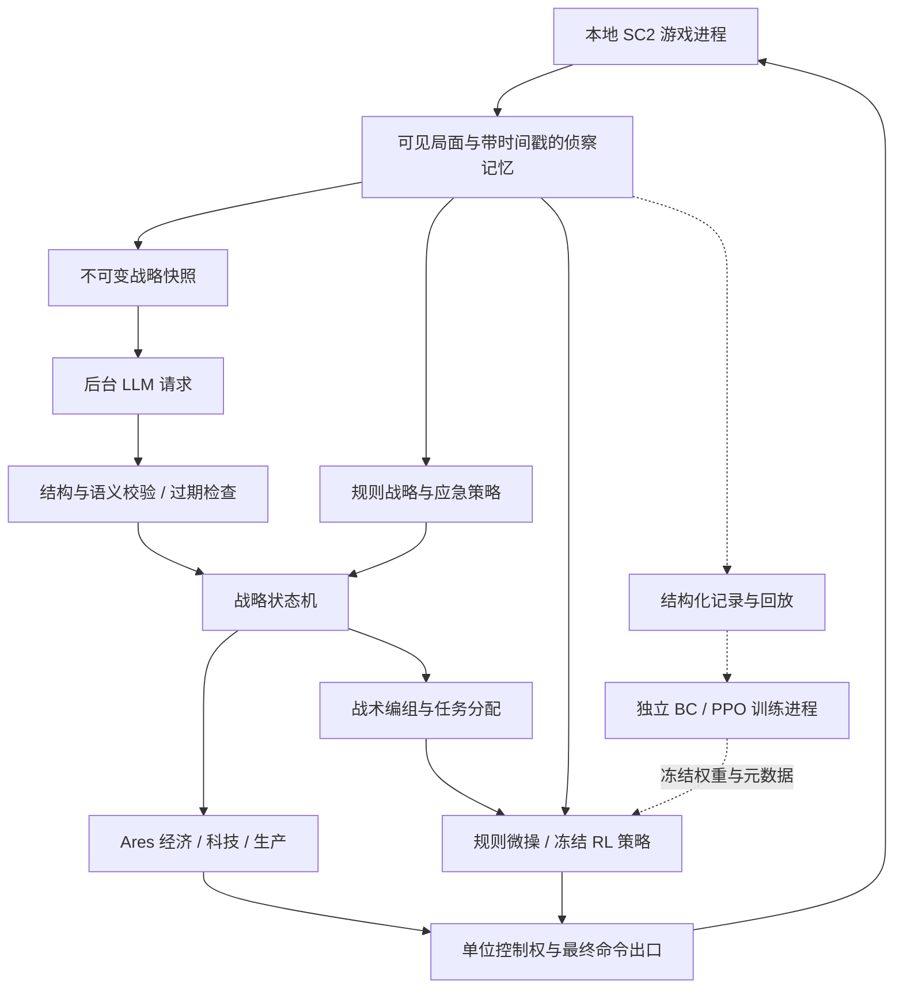

# Ares-SC2 + LLM 战略决策 + RL 微操：本地开发规划

版本：v1.2
日期：2026-10-14
当前状态：P0/P1规则基线通过；P2受限Marine战略首版工程验收通过（影子测试＋同配置规则/LLM各一局完整实时获胜，31次真实API计划）。正式战略强度比较未完成；RL尚未接入。实际证据见 `D:\CODE\sc2-ares-llm-rl\docs\PHASE_01_REPORT.md` 与 `docs\PHASE_02_REPORT.md`。
用户目标：在本地计算机上运行完整的《星际争霸 II》对局，让 LLM 担任上层战略决策者，Ares 负责稳定执行，强化学习模型负责局部战斗微操。**不参加 AI Arena，不以其联网、包体、运行环境或参赛规则约束本项目。**

## 1. 项目目标与实施原则

按以下顺序建立可独立启动、可比较、可回退的版本：

1. **Ares 稳定规则版**：先证明可以正常采矿、建造、产兵、作战并结束完整对局。
2. **Ares + LLM 战略版**：只替换战略决策来源，经济执行与规则微操保持基线实现。
3. **Ares + LLM + RL 混合版**：先在固定规则战略下评估 RL，再评估与 LLM 的组合效果。

最终目标分为三类，分别验收：

| 目标 | 要回答的问题 | 证据 |
| --- | --- | --- |
| 工程可用性 | 能否完整运行，模型超时是否会卡住，是否有命令冲突？ | 完整对局、故障注入、时延、异常日志、回放 |
| 战略能力 | LLM 能否根据侦察与局势做出有效调整？ | 相同微操下规则战略与 LLM 战略的对照 |
| 微操能力 | 学习策略能否比规则微操更有效地战斗？ | 固定局部场景、冻结战略、独立测试集、多训练种子 |

工程正常运行不等于战略更强；训练损失下降不等于战斗能力提升；短时测试通过不等于整局稳定。每阶段均保存实际证据，未通过的候选不进入默认启动路径。

本规划中的阈值、排期、目录和命令属于拟定的实施契约。除明确列为现有事实的内容外，均未实施、未测得性能或胜率。

## 2. 当前基础与新项目边界

### 2.1 已有资产

| 项目 | 当前已知状态 | 对新项目的用途 |
| --- | --- | --- |
| 现有仓库 | `D:\CODE\Large-Language-Models-play-StarCraftII` | 对照和经验来源，保留现有运行能力 |
| 游戏本体 | `D:\game\StarCraft II`，此前识别 Base97579 | 新项目优先使用同一本地游戏，实施时重新读取版本 |
| 地图 | 此前已安装项目提供的 6 张地图 | 先选可实际加载的地图建立基线，地图名与哈希入档 |
| 旧 Conda 环境 | `llm-starcraftii`，Python 3.10 | 保留；不直接作为 Ares 新项目环境 |
| LLM | 已有 DeepSeek 兼容接口配置 | 使用同一提供方；密钥只从本机私有配置读取 |
| 硬件 | 此前验证 RTX 2060 可用 | 小型微操训练的候选设备，显存与吞吐需实测 |
| 实时调度经验 | 后台请求、单请求在途、本地回退、过期计划处理 | 迁移设计思想及经验证的纯逻辑，避免整套旧代码搬入 |

现有项目曾完成 120 秒实时回归测试，游戏时间/实际时间约 0.995；这不是新 Ares 项目的测量结果，也不是完整对局验收。曾出现模型 APIConnectionError，以及新游戏技能编号 4135 被旧 SDK 技能表遗漏而崩溃的问题，需要纳入新项目兼容测试。

### 2.2 拟建工程

- 新项目目录建议：`D:\CODE\sc2-ares-llm-rl`。
- 基于官方 `ares-sc2-bot-template` 初始化，固定模板与 Ares 子模块 commit。
- 建议首版：**Terran / Marine**，沿用用户提供的开发手册；这是一项可调整的规划假设，不表示用户已明确指定种族。
- 首先实现 Marine 地面部队；坦克、运输、混合兵种和复杂技能在基线稳定后添加。
- 不将旧仓库的 238 项依赖复制到新工程，不直接修改旧环境中的 SDK 来支撑新工程。
- v1.0 交付时仅创建规划文档；用户随后授权逐步开发，新工程和运行环境已建立。LLM 与 RL 尚未启用。

### 2.3 环境管理方案

官方模板当前 `pyproject.toml` 声明 Python `>=3.11, <3.13`，规划采用 Python 3.11，与旧 Python 3.10 环境分开。[官方依赖声明](https://raw.githubusercontent.com/AresSC2/ares-sc2-bot-template/main/pyproject.toml)

建议设置两个独立 Conda 环境：

| 环境 | 用途 | 依赖原则 |
| --- | --- | --- |
| `sc2-ares-runtime` | Ares、规则、LLM、模型推理与本地完整对局 | 以模板及子模块锁文件为基础，增量加入 API 与配置依赖 |
| `sc2-ares-training` | 数据处理、BC、MaskablePPO、训练与导出 | 单独锁定 Torch、Gymnasium、SB3、sb3-contrib 等配套版本 |

优先让 Poetry 使用明确选定的 Conda Python；不要无意再创建第三套解释器。首次安装后记录解释器绝对路径、Poetry 配置、依赖锁、Cython 编译结果，并在独立终端验证。若训练进程需启动游戏，由运行环境解释器启动 SC2 worker，通过版本化 IPC 与训练环境通信。

当前官方模板使用子模块、Poetry，并包含 Cython 构建需求；实施时以实际固定 commit 的代码与锁文件为准。此处不预先写死尚未验证的依赖版本。[官方模板安装说明](https://github.com/AresSC2/ares-sc2-bot-template)

## 3. 总体架构



### 3.1 职责划分

| 模块 | 负责什么 | 边界 |
| --- | --- | --- |
| StateBuilder | 资源、科技、部队、战损、侦察和事件摘要 | 区分当前可见与历史最后发现，不向策略泄漏全图信息 |
| StrategicDirector | 规则与 LLM 计划的统一接入、计划生命周期 | LLM 改变目标；执行层依据现状落实目标 |
| AresAdapter | 经济、科技前置、生产配比、扩张、编组 | API 调用集中封装，固定版本后核对签名 |
| MicroController | 交战检测、规则/RL 选择、动作适配 | 只控制被授权单位，超出支持范围回退规则 |
| OrderArbiter | 指令所有权与重复命令抑制 | 所有相关下令路径必须实际接入，不能只建立空仲裁器 |
| LLMWorker | HTTP 请求、输出解析、用量与耗时 | 不持有可变 SC2 Unit 对象，不直接操作游戏客户端 |
| ScenarioRunner | 局部场景重置、推进、奖励、episode 与进程清理 | 仅训练和评估使用，独立于完整比赛执行 |

Ares 的生产控制器与 MacroPlan 可承接兵种比例及宏观优先级，单位角色系统可承接攻击、防守、骚扰等分配；战略解释器和任务生命周期仍需自行实现。[生产管理](https://aressc2.github.io/ares-sc2/tutorials/managing_production.html)、[单位角色](https://aressc2.github.io/ares-sc2/tutorials/assigning_unit_roles.html)

### 3.2 不可破坏的运行约束

1. SC2 客户端及游戏对象由游戏线程持有，LLM worker 只接收不可变快照。
2. 任何远端请求、模型训练或大规模日志处理都不能阻塞游戏回调。
3. 同一单位在同一决策步只有一个有效控制源；角色切换需要释放、领取和记录。
4. 基地遇袭、明显致命威胁等由本地规则立即处理，优先级高于普通战略计划。
5. 关闭 LLM 或 RL 后，规则路径仍可完整运行。
6. 每局开始重置计划、控制权、历史和计数；模型与 HTTP 配置只初始化一次。
7. 试验版本出现异常或收益不明确时，保留结果并回到最近通过验收的版本。

## 4. 模式与基线管理

### 4.1 拟实现的独立启动模式

| 模式 | 战略 | 微操 | 用途 |
| --- | --- | --- | --- |
| `rule` | 固定规则 | 规则 | 工程基线与回退入口 |
| `llm` | LLM + 规则应急 | 同一套规则 | 测 LLM 的单独增益 |
| `rule_bc` | 固定规则 | BC + 规则回退 | 测行为克隆与接管正确性 |
| `rule_rl` | 固定规则 | PPO + 规则回退 | 隔离测 RL 的单独增益 |
| `hybrid` | LLM + 规则应急 | PPO + 规则回退 | 最终组合研究版本 |

`rule`、`llm`、`hybrid` 为用户日常入口；中间两种用于实验归因。模式是显式配置，启动日志必须打印实际战略来源、微操来源、模型哈希、地图、种子、游戏版本和终止限制。

### 4.2 基线版本

- `baseline-rule-v1`：稳定规则经济、生产、作战与完整运行。
- `baseline-llm-v1`：在相同执行层接入经验证的 LLM 战略。
- `baseline-micro-rule-v1`：冻结局部特征、动作、规则专家和场景。
- `candidate-bc-v1`：通过部署一致性验证的模仿策略。
- `candidate-ppo-v1`：通过独立场景测试的学习策略。
- `baseline-hybrid-v1`：组合评估通过后才建立，不能在创建代码时提前命名为已验证基线。

实施时采用 Git commit/tag + 配置哈希 + 模型哈希保存版本；每轮只启用一个新的主要变量。禁止同时修改战略、奖励、网络、地图和执行频率后把变化归因于某一个模块。

## 5. 阶段 P0：工程建立与兼容性验证

**目标**：得到版本明确、能够启动并观察实际游戏的 Ares 工程。

任务：

1. 读取新目录及上级适用的 AGENTS.md；初始化官方模板和子模块，记录精确 commit。
2. 建立独立运行环境，核对 Python、Poetry、编译工具与实际解释器。
3. 配置本地游戏路径和一张已验证地图，先运行模板原生入口。
4. 记录 SC2 build、地图哈希、依赖版本、启动到首个观测的耗时。
5. 分别验证实时模式与固定帧推进模式：前者服务本地完整对局，后者服务局部训练。
6. 检查新 SDK 对本机版本的技能编号、单位命令和在建统计支持；加入 4135 对应原始命令回归样例。
7. 只有确认最新锁定 SDK 仍有缺口时，才增加项目内兼容适配；不盲目复制旧项目补丁或修改安装目录。
8. 建立每局独立输出目录、回放、异常栈和已拥有进程的清理机制。

交付：`ENVIRONMENT.md`、锁文件、原生启动入口、`compatibility-report.json`、首局回放和日志。

验收：能进入游戏并持续读取状态，主动退出可清理自身进程；兼容回归用例通过。此阶段只证明框架可用，不要求模板有完整经济策略。

## 6. 阶段 P1：Ares 稳定规则版

**目标**：建立后续所有实验的可靠底座。

### 6.1 功能工作包

| 编号 | 工作 | 完成条件 |
| --- | --- | --- |
| P1-01 | 固定开局与科技顺序 | 从初始状态能建立补给、兵营并稳定生产 Marine |
| P1-02 | 采矿与人口 | 工人分配、补工人、补人口和气矿配比持续运行 |
| P1-03 | 扩张与产能 | 有明确资源/安全前置，避免重复在建与长期空转 |
| P1-04 | 规则战略状态机 | 至少包含发展、集结、防守、进攻、回撤；转换原因入日志 |
| P1-05 | 基础战斗 | A-move 基线；随后单独添加冷却拉扯规则候选 |
| P1-06 | 控制权与指令出口 | 采矿、建造、侦察和战斗不相互覆盖；按实际 Ares 调度验证 |
| P1-07 | 完整比赛生命周期 | 正常胜负、主动停止、断连、崩溃分别分类，回放可定位 |
| P1-08 | 可诊断性 | 最新状态、战略状态、建造/生产失败原因和阶段时延可读 |

初期固定一套 Marine 路线，不同时增加坦克、医疗运输机、空投和技能释放。胜负不足时按回放定位经济、战略或微操问题；不靠扩大动作空间掩盖基础故障。

### 6.2 验收顺序

1. 短局检查：2 分钟、5 分钟，观察命令与经济。
2. 完整比赛检查：首个完整胜负结果，排除死循环和无意义僵持。
3. 稳定性批次：2 张地图 × 5 个种子，对固定种族和难度的内置对手，累计 10 局正常结束。
4. 在通过前述批次后，增加不同难度或种族的扩展检查；不混入基线稳定性分母。

门槛：10 局中不出现未处理异常；有持续采矿、生产和实际交战；指令冲突计数为 0；无遗留自有进程。完成 10 局仅作为工程门槛，不宣称崩溃概率为零或具备高胜率。

自动化测试可设置明确的游戏时间上限及壁钟 watchdog。达到上限属于 `truncated`，不可计作正常完整胜负；若因此不足 10 局，需要继续定位和补跑。日常双击入口仍默认完整对局，直到胜负或手动停止。

交付：`baseline-rule-v1`、规则配置、完整比赛汇总、回放索引、日常启动和停止说明。

## 7. 阶段 P2：LLM 上层战略接入

**2026-10-14实施状态**：首版链路已通过工程验证，独立入口为 `run_shadow.cmd` 和 `run_llm.cmd`，研究标签 `baseline-llm-v1`。实际支持受限工人/基地目标、Marine-only、main小队四类任务、严格JSON校验、异步单请求、有效期/承诺期、规则回退和紧急防守。影子5/5计划合法，完整LLM局31/31合法，实时比例0.99398，规则/LLM各1局均正常胜利。尚无胜率改进结论；本次LLM完成用时更长。下文是完整设计，损失交换统计、事件提前查询、通用逐目标completed/cancelled状态机和多局E0/E1评估仍待增强，不将全部设计记作完成。依赖锁与Ares子模块保持原版本，新增SDK结束竞态项目内适配，25项回归通过。

**前置**：P1 通过。该阶段不接入学习微操，保留相同规则战斗路径。

### 7.1 战略输入

向模型发送结构化摘要，首版包含：

- 游戏时间、资源、人口、采矿效率代理、扩张数、产能与科技。
- 自己部队按兵种和任务统计，最近交战的损失与结果。
- 当前可见敌军、敌方已发现科技、最后发现时间和位置。
- 当前战略、执行进度、受阻条件及上次计划实际结果。
- 合法战略选项、已实现的兵种/科技集合、可引用的基地和小队 ID。

不发送每帧全部单位 JSON、无限历史或原始长日志。初始提示词预算目标为 1500–3000 输入 tokens，实际以提供方 usage 为准，不能把字符数当 token 数。先发送摘要和明确枚举，确有信息缺失时再增加字段。

### 7.2 战略输出契约

首版采用目标型 JSON，以下是拟定格式示例，不能直接作为 Ares 原生配置：

```json
{
  "schema_version": "strategy-v1",
  "request_id": "match001-strategy007",
  "snapshot_seq": 87,
  "stance": "defend_then_expand",
  "economy": {"worker_target": 44, "base_target": 2},
  "production_profile": "marine_basic",
  "research_priority": [],
  "squad_tasks": [
    {"squad_id": "main", "task": "defend", "target_id": "own_natural"}
  ],
  "attack_gate": {"min_army_supply": 30},
  "reason_summary": "先守住二矿并补足产能"
}
```

`marine_basic` 必须由代码映射到已实现且受约束的 Ares 生产配置。后续需要动态兵种比例时，再新增 schema 版本，检查比例、科技支持与资源可行性。首版避免允许模型自由编写任意技能编号、代码、地图坐标或不存在的单位任务。

`reason_summary` 只保存简短决策依据，不要求或记录模型隐藏思维过程。计划时长、允许的目标和资源边界由本地程序控制，不允许模型自行放宽。

### 7.3 计划校验与执行

校验顺序：JSON 结构 → 字段类型/枚举/范围 → 请求及观测关联 → 目标仍存在 → 科技/兵种受支持 → 局势是否已经变化 → 与当前投入是否冲突。

每条目标维护 `pending / active / completed / blocked / cancelled / expired` 状态，记录条件、进度和取消原因。缺少资源时等待或安排前置；重复扩张和研究请求按目标 ID 去重。

新计划默认在完成校验后整体替换战略目标，不把新旧任务无限追加。对已投入的建造和科技设置保持规则；紧急防守可打断进攻。拒绝新计划时，继续有效旧计划，旧计划失效后回到规则战略。

### 7.4 非阻塞调度与初始参数

下表均为首轮候选参数，P2 小规模测量后调整，不是既有最优值。

| 参数 | 初始候选 | 设计意图 |
| --- | --- | --- |
| 战略快照 | 每 1 秒游戏时间 | 使用缓存摘要，实际采集频率单独测量 |
| 常规战略请求 | 每 15 秒游戏时间尝试一次 | 模型忙时跳过，不积压 |
| 请求壁钟最小间隔 | 5 秒 | 防止加速模式或事件导致 API 请求洪峰 |
| 同时请求数 | 1 | 明确顺序与成本，无队列积压 |
| HTTP 超时 | 20 秒壁钟，连接超时另设 | 首轮保留现有经验，并记录连接错误分类 |
| 观测最大年龄 | 45 秒游戏时间 | 从采集时刻计算，过时返回值丢弃 |
| 重大战略切换保持期 | 30 秒游戏时间 | 限制无意义反复变更，紧急事件例外 |
| 失败退避 | 5、10、20、40、60 秒壁钟封顶 | 延迟重试期间继续规则与有效计划 |
| 每局请求数量上限 | 初始研究配置 60 次，可调整 | 达到上限转规则，不停止游戏 |

游戏时间与壁钟必须分别记录：战略有效性依据游戏进度，网络超时依据实际时间。LLM 比较默认使用实时完整对局；RL 局部训练采用固定帧推进，不调用远端模型。

基地遇袭、敌方关键科技被侦察到、重大交战结束和扩张受阻可触发提前请求。事件合并与去抖；忙碌时只保留待评估事件，下一次发送最新快照。应急动作立即由本地规则执行。

### 7.5 从观察到接管

1. **契约测试**：用固定快照和假回复检查解析、越界、过期、错请求 ID、目标消失。
2. **影子模式**：LLM 给出计划但不执行，与规则实际选择对照。
3. **有限接管**：先只允许发展/集结/防守/进攻姿态与目标选择。
4. **宏观接管**：再逐项开放工人、扩张、生产路线和科技优先级。
5. **完整战略版**：形成可独立启动的 `llm` 模式。

故障注入覆盖：超时、断网、429/5xx、空内容、非法 JSON、未知字段、不可能的目标、延迟回复及退出时仍有请求。API 适配依据固定 SDK 和提供方实际支持能力实现，不假设所有接口支持同样的结构化输出或参数。

验收：模型故障不会阻塞观测与本地生产；无效或过时计划不会执行；固定策略配置可回退；局级用量可审计。使用与规则基线相同的地图/种子完成一轮实际比赛后，再运行正式效果比较。

交付：`baseline-llm-v1`、战略 schema、提示词版本、计划状态日志、故障报告、规则对照结果。

## 8. 阶段 P3：微操接口、规则专家与数据采集

**目标**：先把微操接管和数据时间对齐做正确，不立即训练 PPO。

### 8.1 支持范围

- 首版只接管被选中的 Marine，敌人必须当前可见。
- 受控单位在局部交战半径内才进入微操，离开交战后恢复小队任务。
- 低血量撤退、无法处理的敌方类型、路径不可达或策略异常均可回退。
- 坦克、运输机、建筑和工人仍由各自规则控制；未训练过的兵种不自动纳入 RL。

### 8.2 特征与动作契约

采用手册的 `marine-16-v1` 作为设计起点：己方生命/护盾/冷却、相关敌人的相对位置与状态、邻域双方数量、战略目标相对位置，共 16 维。

实施前明确并冻结：

- 敌人选择需同时考虑可见性、攻击能力与威胁相关性，避免文字定义与代码过滤不一致。
- 邻域友军计数是否排除自己、是否包括建筑与非战斗单位。
- 无敌人时的填充值、合法动作、当前订单保留方式。
- 归一化半径、冷却常数、坐标单位、单位半径和目标集合。

五个动作：攻击最近目标、攻击最低有效生命目标、短距离后撤、短距离靠近、保持。**首版 HOLD 定义为不发送新命令、继续当前订单**；不与 `hold_position()` 混用。

动作掩码与执行器使用同一目标和路径规则。执行前重新验证存活、可见性、攻击类型、移动可达性与当前订单，抑制重复指令。不要让 RL 输出任意 AbilityId 或原始连续坐标。

文档的 16 维向量没有明确的“任务类型”特征，因此首版 RL 只承担共同的局部交战任务。LLM 发出撤退时，由规则撤退控制接管；模型不能凭空理解新增任务。未来若支持守点、护送等条件，必须升级特征/动作版本并补充训练。

### 8.3 调度与仲裁

- 决策周期用明确的 `game_loop` 差定义，不仅按 `on_step` 回调次数取模；实时模式可能跳过帧。
- 首轮候选为每 8 个游戏循环刷新微操，具体在 P3 基线测量后冻结。
- 训练步推进相同数量的游戏循环；实战记录实际间隔与跳帧比例。
- 使用游戏帧定义切换冷却；每次命令记录单位 tag、owner、动作、目标和帧号。
- 所有影响受控单位的 Ares 行为必须过滤这些 tag；验证其实际执行顺序，不能只依赖角色名字。

### 8.4 数据采集

记录 `match_id / engagement_id / unit_tag / game_loop / obs / mask / requested_action / executed_action / command_result / reward / next_obs / terminated / truncated / versions`。

SC2 命令提交后可能被引擎拒绝，数据不能把“尝试执行”当作“已成功执行”。单位死亡后补齐最终转移；接管切换与异常要标记，不能跨 episode 拼接。

训练/验证/测试按整场交战或比赛分组，避免相邻帧跨集合。归一化统计只从训练集得到。调试全知信息可用于场景生成和单独诊断，但不得进入部署策略观测或奖励的不可见情报捷径。

验收：关闭学习策略时，微操规则可运行；无控制冲突；动作与数据时间对齐；特征、掩码与边界测试通过。采集量依据有效交战覆盖和验证曲线决定，不预设“大量重复帧就够用”。

## 9. 阶段 P4：行为克隆与本地推理部署

**目标**：用实际示范数据完成第一次可加载、可回退的学习策略闭环。

1. 采集规则 A-move 与规则拉扯示范，区分专家版本；标签映射严格对应五个动作。
2. 训练 `16 → 64 → 64 → 5`、Tanh 小型 Actor，固定种子并按交战划分验证集。
3. 只使用合法专家动作训练，记录动作分布、验证准确率和各类动作召回，避免全部 HOLD 产生虚假高准确率。
4. 导出权重及模型元数据：特征、动作、归一化、决策周期、训练数据版本、权重哈希。
5. 本地可采用 NumPy 推理；其目的是便于诊断和验证，不受赛事包体要求驱动。若 Torch/ONNX 实测更合适，可以另立候选比较。
6. 对至少 1000 条真实与边界特征比较训练端/部署端 logits；初始数值目标为最大绝对差小于 `1e-4`，近似并列动作另行记录。
7. 通过固定场景验证、模型缺失/损坏回退，再接入 `rule_bc` 模式。

通过标准：没有非法或非有限输出导致的崩溃；导出前后数值一致；规则与 BC 使用相同观测、动作适配器和场景。BC 只能证明模仿能力，不预设其胜过规则专家。

若 BC 候选未达到实战预期，保留规则微操默认并分析数据覆盖、标签和执行语义；不能只增加训练轮数后直接上线。

## 10. 阶段 P5：训练桥接与 PPO 改进

### 10.1 训练环境是独立工作包

`AresBot.on_step()` 不能直接代替 Gymnasium 环境。需实现：

| 接口 | 必须满足的语义 |
| --- | --- |
| `reset(seed, scenario)` | 重置阵容、位置、血量、对手脚本与历史，返回首个合法观测 |
| `step(action)` | 确认动作对应当前状态，推进固定游戏循环，返回对齐的转移 |
| `action_masks()` | 返回当前合法动作集合，始终至少允许 HOLD |
| `close()` | 清理本环境持有的 SC2 worker、端口及 IPC |
| 健康检查 | 超时、断连和子进程死亡单独分类，能够清理和重建 |

IPC 携带 `episode_id / decision_id / unit_slot / frame`，拒绝旧回复。训练端做梯度更新，游戏端只执行动作和产生转移。端口、输出目录和进程归属逐环境隔离。

先完成 **单个受控 Marine 的 Discrete(5) 环境**，敌人用固定脚本。验证 1v1 后扩展地形和敌人数量；再设计固定槽位 MultiDiscrete 或多智能体接口。不能把多个独立单位的动作硬塞进一个 Discrete(5) 并称为多单位策略。

死亡槽位只允许 HOLD；动态单位数量、有效样本掩码与团队奖励归因在扩展前明确。首版避免把同一团队奖励为每个单位重复求和放大。

### 10.2 算法路线

拟优先使用 **sb3-contrib MaskablePPO**，减少从零实现 PPO 的风险；以实际可兼容的固定版本为准。训练时和评估时都使用动作掩码，采用相应的评估工具；多进程环境需在环境内部实现掩码接口。[MaskablePPO 官方文档](https://sb3-contrib.readthedocs.io/en/master/modules/ppo_mask.html)

BC 与 PPO 的权重不能直接互换。P5 开始前做技术验证：

1. 显式配置 PPO Actor 的层宽、激活与输入变换，与 BC 设计对齐。
2. 仅将经形状及数值验证的 BC Actor 参数迁移到匹配的策略层；critic 独立初始化。
3. 为固定 SB3 policy 编写专用部署导出器；不能复用只认识自定义 Actor.state_dict 的旧导出器。
4. 校验 BC → PPO 策略初始化、PPO → 部署推理的 logits 和掩码动作一致性。
5. 若迁移成本高，先独立完成 PPO 随机初始化基线，再增加 BC 初始化作为单独候选，不将“BC→PPO”写成已经完成的功能。

初始候选：学习率 `3e-4`、gamma `0.99`、GAE lambda `0.95`、clip `0.2`。先短训练检查更新、掩码、奖励与评估，再据吞吐及 episode 长度选择 rollout 和 batch，不能仅照抄 200 万步即认为训练完成。

### 10.3 奖励、终止与场景

首版奖励采用局部敌方有效生命损失减己方损失，固定缩放；终局胜负另给奖励。明确定义视野消失、治疗、死亡单位最终生命值和护盾变化，避免把“看不见了”当成击杀或重复计算伤害与资源价值。

团灭/目标达成属于 `terminated`；场景时间上限属于 `truncated`，按固定算法版本的方式处理 bootstrap。进程崩溃、IPC 超时是系统失败；标记并排除或丢弃受污染 rollout，不转换成战术胜负或高奖励。

课程顺序：1v1 Marine → Marine 对近战威胁 → 不同距离和血量 → 地形/高低地 → 固定小队。每次只增加一个主要难度因素。完整比赛和 LLM 变化不进入第一阶段训练。

### 10.4 算力与吞吐

- 首先单环境测量启动、重置、游戏步、IPC、训练更新及有效样本/秒。
- CPU 与游戏模拟可能是瓶颈，不把 GPU 可用当成训练一定快。
- 只有单环境稳定、内存及端口清理通过后，才比较 1 路与 2 路训练。
- 保存 checkpoint、优化器、随机状态、训练和场景版本；恢复训练需验证进度连续。
- 先用短作业判断信号，再安排长训练；预计耗时由实测样本吞吐计算并注明重置成本。

交付：可真正 reset/step 的环境、场景集、训练入口、模型/导出器、训练曲线和冻结测试结果。若学习策略没有稳定收益，最终微操继续使用规则版。

## 11. 阶段 P6：组合评估与本地长期运行

**目标**：验证 LLM 与 RL 的组合是否有额外价值，并交付易启动的本地完整对局版本。

### 11.1 最小对照集合

| 实验 | 战略 | 微操 | 回答的问题 |
| --- | --- | --- | --- |
| E0 | Rule | Rule | 工程与效果基线 |
| E1 | LLM | Rule | LLM 战略的增益 |
| E2 | Rule | BC | 模仿策略的效果与集成正确性 |
| E3 | Rule | PPO | RL 微操的单独增益 |
| E4 | LLM | PPO | 完整组合及层间交互 |

先做 E0/E1，再 E2/E3，最后 E4。E4 的收益不能直接归因于 RL；必须结合 E1、E3 解释。固定宏观执行器、对手版本、地图、游戏 build 与测试种子，交叉安排模式运行顺序。

局部微操阶段先完成同场景的 Rule/BC/PPO 比较，完整比赛不是唯一评价。LLM 的提供方行为可能变化，记录模型名、参数、请求日期、提示词版本及响应；相同 SC2 seed 不保证远端模型输出完全可复现。

### 11.2 评估规模与判断

- 工程 smoke：每模式 2–3 局，仅检查接入。
- 第一轮完整比较：每核心模式 2 张地图 × 10 个种子，共 20 局；这是探索规模，置信区间可能很宽。
- 正式学习效果：至少 5 个独立训练种子；每个模型在预先冻结的场景集上评估，报告种子间差异。
- 按比赛/交战而不是逐单位逐帧作为独立统计样本；配对差值可按种子或场景分组 bootstrap。
- 完整胜率报告 Wilson 95% 区间、实际分母、崩溃/截断/未完成数；同时报告把系统失败计入后的端到端成功情况，避免丢弃失败美化结果。
- 测试集不用于反复选模型；调参使用验证集，最终测试后若继续改模型须单独标记新轮次。

未得到稳定改善时，不强制启用 LLM/RL；可以交付多个模式并明确当前默认采用哪一个。系统可运行与算法有效性分别结项。

### 11.3 指标

| 类别 | 指标 |
| --- | --- |
| 完整比赛 | 胜率及区间、比赛局数、游戏时长、经济/军队发展曲线 |
| 战略 | 计划有效率、采纳/拒绝/过期率、执行完成率、战略切换与应急次数 |
| LLM 服务 | 请求数、成功/错误类型、p50/p95/p99、tokens、按配置单价计算的成本 |
| 微操 | 场景胜率、双方有效生命/资源损失、存活率、非法动作率、回退率 |
| 运行 | on_step、观测、策略、适配器的时延分位数，观测间隔、实时比例 |
| 稳定性 | 崩溃、断连、超时、进程泄漏、重复/冲突命令 |

本地实时性能的初始工程目标：活跃游戏区间游戏时间/壁钟时间在 0.95–1.05，游戏回调 p95 小于 50ms，小模型批量微操推理 p95 小于 10ms。上述是待测目标，不是官方限制或已验证结果；地图、图形负载和单位规模必须随结果一起记录。加载、结束和保存回放耗时独立统计。

### 11.4 本地交付

- 三种主要模式的双击启动脚本，默认完整对局。
- 一键查看有效配置、切换规则回退、选择地图/难度/种子/模型。
- 每局状态 JSON、战略计划摘要、模型状态与回放定位文件。
- 模型缺失或 API 断连时继续比赛；退出只清理自己启动的进程。
- API 成本限制达到时回到规则，不结束游戏。
- 首版不新增网页监控、云服务或复杂容器部署，确有使用需求再增加。

## 12. 拟定目录与模块交付

```text
D:\CODE\sc2-ares-llm-rl\
  ares-sc2/                       # 固定子模块
  bot/
    main.py                      # Ares 生命周期
    strategy/
      director.py                # 计划状态机、规则回退
      rule.py                    # 冻结规则战略
      schema.py                  # strategy-v1
      executor.py                # 目标到 Ares 行为
    llm/
      client.py                  # 提供方适配、超时与用量
      worker.py                  # 单请求后台调度
      snapshot.py                 # 可见局面摘要
      prompts/strategy_v1.txt
    micro/
      observation.py             # 训练与部署共享
      actions.py                 # 动作与掩码
      arbiter.py                 # 所有权和最终出口
      controller.py              # 接管与回退
      rule.py
    policy/
      loader.py
      numpy_actor.py
      models/                    # 权重与元数据
    telemetry/                   # 分阶段计时、命令与运行状态
    compat/                      # 仅在实测必要时加入适配
  training/
    arena_env.py
    scenario_worker.py
    protocol.py
    collect.py
    train_bc.py
    train_ppo.py
    export_bc.py
    export_sb3.py
  evaluation/
    scenarios/
    suites/
    run_matches.py
    summarize.py
  configs/
    rule.yaml
    llm.yaml
    hybrid.yaml
    micro_train.yaml
  tests/
  docs/
  artifacts/                     # 每次实际运行独立目录
  .env.local                     # 本机私有，忽略
  .env.example                   # 占位配置，无密钥
  config.yml                     # 官方模板配置，保留其语义
  run.py / ladder.py              # 模板入口；本地研究优先
  run_rule.cmd / run_llm.cmd / run_hybrid.cmd
  pyproject.toml / poetry.lock
```

上述目录为目标结构，目前P0/P1所需子集已建立，实际入口是run_rule.cmd、run_local.py与tools/下的验证工具，详见阶段报告；LLM、训练与复杂战术模块仍为拟建内容。自定义 YAML 需要显式解析与 schema 校验，不假设 Ares 自动理解。保留模板中未使用的入口不意味着要开发或测试参赛功能。

## 13. 配置、日志与结果管理

### 13.1 配置分层

固定 defaults → 运行模式配置 → 本机环境路径/凭据 → CLI 显式覆盖。启动打印最终非敏感配置和来源，保存其哈希。实验运行使用完整解析后的配置快照，不只保存 CLI。

LLM key 仅保存在受忽略的本机文件或环境变量；不进入规划、示例、进程命令行、回放说明与 Git。日志清理敏感字段，错误正文按需要截断和清理。旧项目的私有配置可以在实施时受控读取，不在报告复制凭据。

### 13.2 每次运行记录

```text
run_id, mode, start_utc, end_utc, status,
project_commit, ares_commit, dirty_diff_hash, dependency_lock_hash,
python_path, sc2_build, map_name, map_hash, opponent, difficulty, seed,
strategy_schema, prompt_hash, llm_provider, llm_model, request_options,
feature_version, action_version, reward_version, decision_game_loops,
policy_sha256, train_split_hash, scenario_version,
normal_result, stop_reason, game_seconds, process_seconds,
tokens, api_errors, fallback_count, conflict_count,
timing_summary, replay_path, log_path
```

训练另保存训练种子、优化器、样本数、更新数、验证选择依据和恢复来源。未记录的字段写未记录，不从模型名称推测版本。

### 13.3 结果文件

每次运行输出 `config.resolved.json`、`manifest.json`、按进程独立的 `events.jsonl`、`summary.json`、回放与必要模型引用。避免 Windows 多进程同时追加同一 JSONL 导致损坏；汇总时按 run_id 和时间合并。

正常胜负、人工中断、限时测试、游戏时间截断、API 降级和系统崩溃各有独立状态。后台请求在退出时未完成不等于游戏崩溃，但需记录。

## 14. 风险与处理顺序

| 风险 | 发现方式 | 处理 |
| --- | --- | --- |
| 游戏新版本与 SDK 不兼容 | 命令转换和在建统计回归、真实回放 | 固定已验证依赖；必要时项目内适配并保存证据 |
| Ares 模板仅能启动，没有完整策略 | 完整对局经济/生产曲线 | P1 补齐规则能力后再接 LLM |
| 多控制源覆盖命令 | 单位/帧命令审计、抖动回放 | 过滤 Ares 行为、统一出口、控制权切换日志 |
| LLM 慢、断网或回复过时 | 请求分位数、快照年龄、错误分类 | 单请求、过期拒绝、退避、本地回退 |
| LLM 战略反复变化 | 计划切换和取消计数 | 有限选项、保持期、投入保护、应急覆盖 |
| 推理或 API 成本失控 | 每局调用及 tokens、实际单价 | 请求数量/token/可选金额上限，可配置后冻结 |
| RL 训练环境语义错误 | reset/step/奖励/死亡/截断回归 | 先单单位固定场景，确认时间对齐再加速 |
| 模型只会 HOLD 或后退 | 动作分布、原始战损和回放 | 检查数据与奖励，规则继续默认 |
| 模型导出或特征不一致 | logits、mask、元数据测试 | 拒绝加载不兼容模型，回退规则 |
| 训练快但部署慢或间隔不同 | 固定游戏帧评估、实战间隔分布 | 共享适配器，记录实际间隔，限制不支持场景 |
| 微操变好但整局变差 | 局部与完整指标对照 | 冻结宏观做归因，再研究交互 |
| 并行 SC2 耗尽资源 | CPU/内存/进程/端口观测 | 单环境起步，按证据增加并行度 |

## 15. 里程碑与工作量估算

以下为有效开发工作日估算，不是日历承诺；完整比赛、训练和下载的等待时间另记。最大不确定性在场景桥接、宏观稳定性与学习收益，遇到失败先修复当前阶段，不靠压缩验证进入下一阶段。

| 阶段 | 预计工作日 | 进入条件 | 里程碑 |
| --- | ---: | --- | --- |
| P0 工程与兼容 | 1–3 | 开始实施 | 环境锁定、首局和兼容报告 |
| P1 规则底座 | 4–8 | P0 通过 | 10 局完整运行、规则基线 |
| P2 LLM 战略 | 3–6 | P1 通过 | 结构化计划、故障回退、E0/E1 |
| P3 微操与采集 | 3–6 | P1 通过；实施次序安排在 P2 后 | 统一命令、共享特征、规则数据 |
| P4 BC 闭环 | 2–4 | P3 数据与契约通过 | 冻结 BC、部署一致性、E2 |
| P5 桥接与 PPO | 7–15 | P3/P4，或明确采用独立 PPO 基线 | 真实环境、训练、冻结评估、E3 |
| P6 组合与交付 | 3–6 | 可比较的 E1/E3 | E4、本地启动和研究报告 |

合计约 23–48 个有效工作日；训练达到有效策略所需时间目前未知。第一次单环境吞吐测量后才能估计训练时长。可在 P1 或 P2 形成可用版本后停留使用，RL 效果不佳不妨碍交付稳定本地 Bot。

## 16. 启动、验证和回退契约

**以下是目标启动接口：run_rule.cmd及其测试参数已在P0/P1实现和验证，run_llm.cmd与run_hybrid.cmd仍为后续拟建入口。** 当前实际验证使用 `python -s -m unittest discover -s tests -v`、`python -s tools/evaluate_rule.py` 和 `python -s tools/report_suite.py`；下方training/evaluation命令仍是未来接口，不是已经存在的脚本。

拟在新项目根目录提供：

```bat
run_rule.cmd
run_llm.cmd
run_hybrid.cmd
run_hybrid.cmd --show-config
run_hybrid.cmd --max-game-seconds 120 --seed 42
```

默认完整对局，最后一条仅用于显式限时回归。关闭学习微操使用 `run_llm.cmd`；同时关闭远端战略使用 `run_rule.cmd`。回退改变决策来源，不要求卸载环境或删除训练资产。

拟实现的验证入口：

```text
python -m pytest tests/
python -m evaluation.run_matches --suite evaluation/suites/rule_smoke.yaml
python -m evaluation.run_matches --suite evaluation/suites/llm_ab.yaml
python -m training.collect --config configs/micro_collect.yaml
python -m training.train_bc --config configs/bc.yaml
python -m training.train_ppo --config configs/micro_train.yaml
python -m evaluation.summarize --runs artifacts/<实验批次>
```

这些入口需在对应阶段编写，使用明确的运行/训练解释器，并在交付时替换为实际测试过的完整命令。单测验证纯逻辑与边界，真实完整比赛验证框架集成；二者不能互相替代。

### 每阶段交付表

| 交付项 | 前置与作用 | 应用/启动/验证 | 当前状态 | 回退 |
| --- | --- | --- | --- | --- |
| 本规划 | 用户手册、当前项目事实与官方资料 | 阅读此文档 | 已编写；非实现 | 修改文档版本 |
| Ares 规则版 | 新环境与 P0，建立完整底座 | 实际run_rule.cmd、tools/evaluate_rule.py | 已创建、启用；10局完整固定步及1局完整实时验收通过；baseline-rule-v1 | 保留旧项目；新项目可按基线标签独立检出 |
| LLM 战略版 | P1，替换战略来源 | 拟定 llm 入口与 E0/E1 | 未创建、未启用、未验证 | rule 模式 |
| BC 微操 | P3 与真实数据，验证学习闭环 | BC 训练/导出/一致性与 E2 | 未创建、未训练、未验证 | 规则微操 |
| PPO 微操 | 真实训练桥接与冻结契约 | PPO 训练/导出与 E3 | 未创建、未训练、未验证 | BC 或规则，依据实测选择 |
| 完整混合版 | E1/E3 工程与评估通过 | hybrid 入口与 E4 | 未创建、未启用、未验证 | llm 或 rule 模式 |

正式实施的每轮报告沿用此表，补充补丁作用、实际执行位置、依赖、完整启动/验证命令、结果证据与回退。明确区分代码已添加、配置已应用、功能已启用和真实实验已验证。

## 17. 第一轮实施清单与待确定事项

开始实施后，第一轮只做 P0 与 P1 的最小闭环：

1. 建立新目录及独立环境，固定模板和子模块。
2. 使用本机游戏与已验证地图运行原生模板。
3. 实现最小 Marine 经济、生产和 A-move，明确命令所有权。
4. 完成 2 分钟与 5 分钟检查，再争取首个完整胜负结果。
5. 交付运行方式、回放、已知问题和下一轮单一候选，不提前接入 PPO。

规划采用的可调整默认项：

| 事项 | 当前规划选择 | 何时需要确定 |
| --- | --- | --- |
| 首版种族 | Terran / Marine | P0 配置前；若改 Protoss，重定微操特征与场景 |
| 首版对手 | 内置 Zerg Medium | P1 开始，固定难度便于回归 |
| LLM 提供方 | 复用本机 DeepSeek 接口 | P2 开始，重新验证实际模型可用性 |
| API 预算 | 先限制单局调用，金额阈值按实际需求配置 | 首次批量 API 实验前 |
| 首轮地图 | 从本机已验证地图中选 1 张，再扩到 2 张 | P0/P1，根据实际可加载结果固定 |
| 训练设备 | 本机单环境、小模型起步 | P5 吞吐测量后再决定是否加资源 |

这些默认项不阻塞规划交付；如用户改变某项，更新受影响的阶段和基线，保留变更记录。v1.0 交付时仅授权编写规划；用户随后明确授权开始逐步实施。当前按规则底座优先执行，不把后续学习模型训练标记为已完成。

## 18. 依据与版本核查

用户资料：`C:\Users\27932\Downloads\Ares-SC2_RL_Micro_Hybrid_Development_Manual.md`，已通读；其中代码示例与待实现模块分别对待，未当作现成可运行工程。

本轮核查的主要官方资料（2026-10-14）：

- [Ares 官方模板与安装](https://github.com/AresSC2/ares-sc2-bot-template)：工程初始化、子模块、Poetry 与构建方式。
- [模板 pyproject.toml](https://raw.githubusercontent.com/AresSC2/ares-sc2-bot-template/main/pyproject.toml)：当前 Python 范围及依赖声明。
- [Ares 生产管理](https://aressc2.github.io/ares-sc2/tutorials/managing_production.html)：宏观计划、产能与单位生产。
- [Ares 单位角色](https://aressc2.github.io/ares-sc2/tutorials/assigning_unit_roles.html)：单位任务与角色分配。
- [MaskablePPO](https://sb3-contrib.readthedocs.io/en/master/modules/ppo_mask.html)：训练、评估和多进程动作掩码接口。

实现时记录具体 commit 与包版本，在线 main/master 文档只作为当前核查依据。用户已明确不参加 AI Arena，其比赛规则与打包要求未列为本项目约束或里程碑。

## 19. 文档变更记录

| 日期 | 版本 | 变更 |
| --- | --- | --- |
| 2026-10-14 | v1.0 | 形成规则 → LLM → RL 的本地开发与实验规划；按用户澄清移除 AI Arena 参赛目标与部署任务 |
| 2026-10-14 | v1.1 | 用户授权开始开发；新项目已建立，P0通过，P1验收中；用户提供SmoothBrain源码及压缩包作为实现参考 |
| 2026-10-14 | v1.1补充 | P0/P1验收完成，规则基线baseline-rule-v1；10局固定步及1局默认实时完整对局均正常获胜，范围限内置Zerg Medium |
| 2026-10-14 | v1.2 | P2战略首版工程验收通过，baseline-llm-v1；后台API/目标接管/故障回退/影子模式可用，同配置规则与LLM各一局完整实时获胜；正式策略收益评估与其余增强未完成，RL未开始 |
